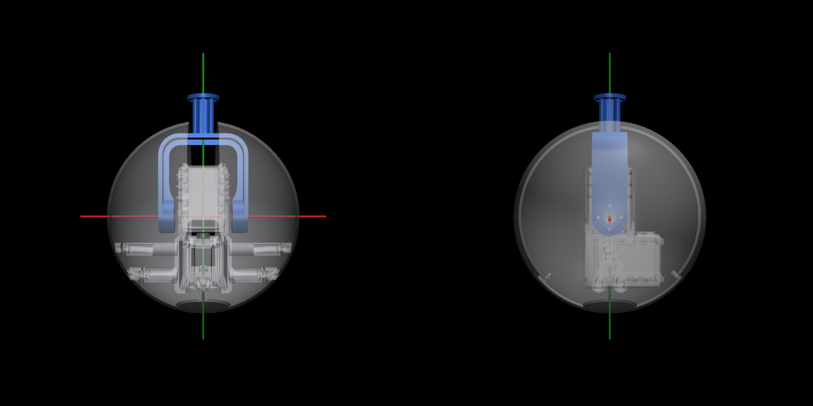

# CATENA

CATENA is a chain of 12 spherical modules that folds itself into shapes: the MIT Universal Self-Folding Chain Robot
(Mutis et al., ACM SCF 2025). This repo also holds the microgravity experiments we're designing for it, for MIT
16.88J / Columbia AERO E4450 in Fall 2026.



## What's where
| Folder | What's in it | Start here |
|---|---|---|
| `hardware/` | CAD and measurements of the chain | `hardware/AGENTS.md` |
| `software/` | Code for the real chain (to come) | `software/AGENTS.md` |
| `simulation/` | MuJoCo model: zero-g folding, spin, gravity, logging | `simulation/README.md` |
| `sequences/` | Fold sequences (CSV): scripted moves that the sim plays and the chain will play | `sequences/README.md` |
| `experiments/` | The flight experiments, what the sim predicts, measured findings | `experiments/README.md` |
| `docs/` | Proposal and course syllabus | |

## Quick start: the simulation
This needs [uv](https://docs.astral.sh/uv/).

```bash
cd simulation
```

```bash
uv venv --python 3.11 .venv
```

```bash
uv pip install --python .venv/bin/python -r requirements.txt
```

```bash
.venv/bin/python verify.py
```

The last command should end with `ALL CHECKS PASSED`. On a Mac, double-click `simulation/Chain Sim.command` to get the
control window and 3D viewer. More is in `simulation/README.md`.

## Working with a coding agent
- **`AGENTS.md` files** tell coding agents (Claude Code, Codex, Cursor, Copilot, ...) how this repo works. There's one
  at the top and one in each area, and agents read them automatically.
- **Agents log their work** in each area's `LOG.md`, and keep that area's `AGENTS.md` current.
- **If you change how something works by hand,** check that the `AGENTS.md` in that folder still says the truth.
