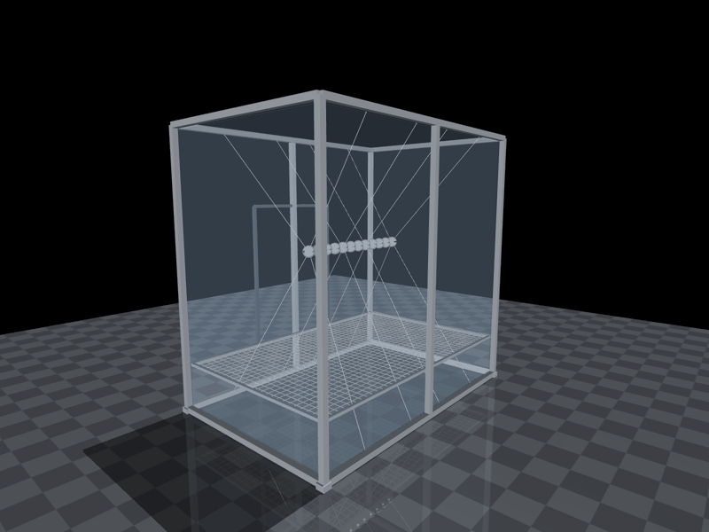
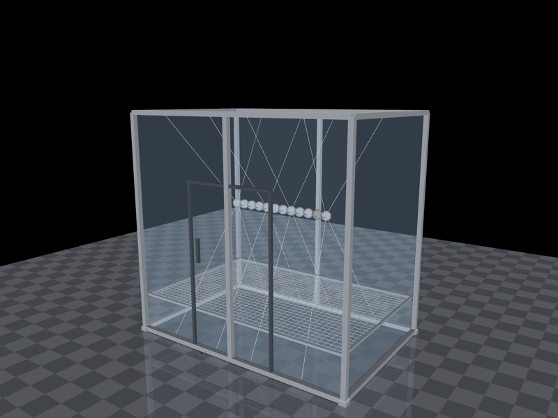
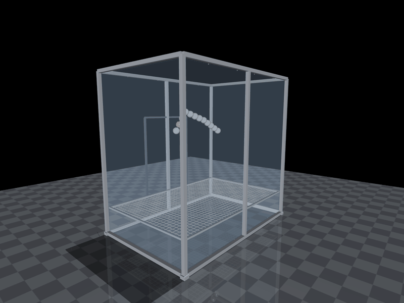

# Chain Sim: a guide for first-timers

Chain Sim is the simulation of CATENA, our 12-module folding chain. It flies the chain the way it will fly on the
parabolic flight: in the experiment box on the Novespace A310, held by strings through the 1.8 g pull-up, let go in
zero g, and caught by the net at the end. You drive it from a control window with buttons; a 3D viewer shows what
happens.

This guide is for clicking. The only typing is the setup you do once. `README.md` has the details behind each part
(commands, the model, the physics choices).



## 1. Install it (once, about 5 minutes)
You need a Mac and a copy of the repo (https://github.com/wesleyshe/catena), for example cloned with GitHub Desktop.

1. **Install uv**, the tool that sets up Python for the sim. Follow https://docs.astral.sh/uv/ (on a Mac with
   Homebrew, `brew install uv` works).
2. **Open Terminal** and go to the `simulation` folder: type `cd ` (with a space), drag the `simulation` folder from
   Finder into the Terminal window, and press Return.
3. **Paste these two commands**, one at a time, pressing Return after each:
   ```bash
   uv venv --python 3.11 .venv
   ```
   ```bash
   uv pip install --python .venv/bin/python -r requirements.txt
   ```
4. **Optional check** (about 2 minutes): `.venv/bin/python verify.py` should end with `ALL CHECKS PASSED`.

That's the last typing. From now on, everything is a double-click or a button.

## 2. Open Chain Sim
Double-click **`Chain Sim.command`** in the `simulation` folder.

- A **Terminal window** opens first. Leave it open: it runs the app, and closing it closes Chain Sim. It also prints
  a one-line summary whenever a run finishes.
- The first time, macOS may ask whether Terminal may access the Desktop folder (if the repo is there). Click **Allow**.
  If macOS refuses to open the file at all, right-click it, choose **Open**, then **Open** again.
- Then two windows appear:
  - the **Chain Sim** control window, which stays on top of other windows;
  - the **viewer**, a 3D view of the chain. At first it shows the bare 14 cm chain floating straight above a grey floor,
    with no box. The demo buttons change that.

To quit, close the control window: the viewer closes with it.

## 3. The demo buttons
The top row of the control window has one button per class simulation. **One click** loads that simulation, reopens
the viewer with it, and flies it: a whole parabola with its sequence, about 80 seconds. Press **Play** for another take;
every take of the same setup comes out the same.

| Button | What you'll see |
|---|---|
| **1A Free float (held)** | Held by strings in the middle of the box, let go, then it folds in loops to turn without pushing on anything (the "falling cat"). The plane's pitch-over makes it roll instead of turn cleanly. It drifts into an end wall near the end of zero g. |
| **1B Free float (from the net)** | The same moves, but it starts lying on the net with no strings. The leftover g lifts it off the net about 2 s into zero g, and it reaches the lid about 4 s later. |
| **2 Anchored** | Clamped by its red anchor to the box's end wall, it works like an arm: curls, turns on its twist servo, reaches, and touches a side wall. |
| **3 Thrusters** | Folds into a U, fires a nozzle on each of its yellow end modules for 2.5 s (a nozzle turns bright orange while it fires), then glides across the box. |
| **4 Suction walk** | Stands on a deck over the net on its two green suction cups, then walks along it in zero g, one foot always holding. |
| **5 Pole climb** | Wrapped round a pole that runs from the box's floor to its lid, it climbs by squeezing, like a snake. |
| **6 Skater** | Let go spinning: folding speeds the spin up, straightening slows it down, like a skater pulling their arms in. |

The other versions of each simulation (more spin at release, the chain turned across the cabin, the Moon and Mars
parabolas, other shapes) are in the **Setup** list; see section 4.

### What the viewer shows
- **The box:** clear acrylic walls with an aluminium frame, a door on the aisle side, and the net across it 300 mm above
  its floor.
- **The strings:** thin white lines from the box's edges to four modules. They vanish when they let go.
- **The big text at the top:** a countdown (T-5 … T-1), then where the flight is: `1.8 g  pull-up  -  zero g in 12`,
  then `zero g  T+3` (seconds since zero g began), then `1.8 g  pull-out`.
- **The readouts**, top left: the same lines as in the control window (section 6).
- **One orange module:** that's the one the keyboard moves (section 6).

## 4. The control window, section by section
Each box in the window is one section. Some settings act at once, some at the next **Play**, and some only after
**Rebuild + open viewer**, which restarts the viewer with them.

| Section | What it's for | When a change takes effect |
|---|---|---|
| **Setup** | Pick a whole run from the list, and **Load** it: it fills in every field below and reopens the viewer. The lines underneath say what the run shows and what's in it. **Save as...** saves the current settings as a new setup. | Load: at once |
| **Model** | The chain: the preset (`feetech85` is the 8.5 cm flight build, `original14` the 14 cm AX-12A chain), how many modules, the slip ring, air drag, and a rod to grab. | Rebuild |
| **End effectors** | An extra module on either end: none, an **anchor** (a clamp), a **suction** cup or a **thruster**. Picking a type shows its settings, and where it starts (floating, on a surface, or on the rod). While it runs: **Hold** / **Let go**, or the nozzle tick boxes n0–n4. | Rebuild (Hold, Let go and the nozzles: at once) |
| **Rebuild + open viewer** | Applies Model, End effectors and the flight box, and restarts the viewer from the start. | |
| **Fold sequence** | The moves: pick a CSV, set **Move s** (time between rows) and **Hold s** (time on each row), then **Play / Pause / Resume / Restart / Stop**. **Speed x** makes the moves faster (the physics changes); **Playback x** only shows the simulation faster than real time (the physics doesn't change). **Countdown s** shows T-5 … T-1 before each take; 0 skips it. | Play |
| **World** | **Gravity** on or off and how strong; **Straighten** (every joint to 0); **Reset pose** (back to the start, at rest); **Pause physics** (freezes everything so you can look around). | At once |
| **Spin** | Gives the whole chain a spin through its centre of mass: a rate, an axis, then **Spin**; **Stop spin** stops it. Tick **Also spin like this when Play starts** to add it as the strings let go, like a sloppy release. | At once (the tick: at Play) |
| **Flight** | The box (its size), which modules the **strings** hold, how long the **1.8 g phases** last, **g-jitter** (the leftover g in zero g), when the strings **let go** and the sequence **starts** (both counted from the start of zero g), **or starts on the net**. Also flying by hand (section 5) and the camera tick. | Box and strings: Rebuild. Times: Play |
| **Record** | **Log to logs/** writes a log while ticked; **Screenshot** saves the viewer's view; **Open folder** opens the `simulation` folder in Finder. | At once |
| **Readouts** | What the viewer reports, five times a second (section 6). | |

## 5. Flying a parabola
A parabola is about 75 s of simulated time. In order:

| Time | What happens | Big text |
|---|---|---|
| Countdown | The chain waits; nothing moves. | `T-5` … `T-1` |
| 26 s | Level flight at 1 g (3 s), then the 1.8 g pull-up as the plane noses up. The strings hold the chain still. **This is the stretch where nothing seems to happen.** | `1.8 g  pull-up  -  zero g in 12` |
| T+0 | Zero g begins. | `zero g  T+0` |
| T+1 | The strings let go. | |
| T+1.5 to about T+21 | The sequence plays. | `zero g  T+9` |
| T+22 | Zero g ends; the pull-out drops the chain onto the net. | `1.8 g  pull-out` |
| End | The **flight** readout says `done:` with how it went. | |

There are two ways to fly it.

**Play (automatic).** With a setup loaded (or after a demo button), press **Play**. Everything above happens by itself.
Press **Play** again for a fresh take.

**By hand.** You decide when the strings let go and when the moves start.
1. Click **✈ Start the parabola (by hand)**. The countdown and the pull-up run as before, and the strings hold.
2. When the big text says `zero g  T+0  Let go when ready`, click **✂ Let go of the strings**.
3. The big text now says `Play: the sequence`. Click **Play** and the sequence starts straight away. Or drive the chain
   yourself instead: the keys, **Spin**, **Hold** / **Let go**, the nozzles.

Let go and press Play within a second or two of T+0, so that a 20 s sequence still fits in the 22 s of zero g. The
**by hand** line in the readouts always says what to do next.

**To wait less,** either:
- set **Playback x** to 2 or 3 before Play. It shows the whole flight faster without changing the physics. If your
  computer can't keep up, the **playback** readout says so (for example `x2 (reaching x0.9)`); or
- set **1.8 g phases, s** (in Flight) to 7, its smallest. Zero g then begins 10 s after the countdown instead of 26 s,
  and the whole parabola takes 42 s instead of 74 s. It applies at the next Play, with no Rebuild. It shortens the
  pull-out too, and it's shorter than the real A310's 23 s, so the chain spends less time held at 1.8 g. A demo button
  or **Load** sets it back to the setup's 23 s; **Save as...** keeps your 7 s in a new setup.

## 6. Watching, readouts, logs and screenshots
**The camera.** With **Camera turns with the plane** ticked, you watch from inside the cabin, so the box looks still
while the plane pitches. Untick it to watch from outside, fixed in space: you'll see the whole box tilt nose-up and
nose-down.



**The mouse in the viewer:** drag with the left button to turn the view, with the right button to move it, and scroll to
zoom. If dragging does nothing, press **Esc** to free the camera first. **Tab** hides the viewer's left panel and
**Shift+Tab** its right one, for more room.

**The keyboard in the viewer** (when no sequence is playing): **PageUp** / **PageDown** choose a module (it turns
orange), **Up** / **Down** bend its pitch joint by 5°, **Right** / **Left** turn its yaw joint by 5°, and **Space**
pauses or resumes the physics.

**The readouts,** in the control window and the viewer's top left:

| Line | What it means |
|---|---|
| time, physics | Simulated time, and whether the physics is running or paused |
| sequence | The CSV, how far through, and how long it is (flagged if it's longer than one parabola) |
| gravity | The g the chain feels right now (it changes through the parabola) |
| spin | The whole chain's spin about the vertical, in deg/s |
| turned | How far the middle module has turned since the start, as the cabin's camera sees it |
| turned, space | The same, fixed in space |
| IMU turn | How far the IMU's module has turned in 3D: what the real IMU will report |
| COM drift, \|L\|, max torque, contacts | The centre of mass's drift, the angular momentum, the strongest servo's torque, and how many things touch |
| ee1, ee12 | Each end effector: holding / ready to grab / let go, and its load (or a thruster's push) |
| box gap | How close the chain is to the box (walls, lid, net) |
| plane | The plane's pitch and how fast it's turning |
| flight | The phase, the g, and T; at the end, `done:` and how it went (when it let go, what it touched first, the landing) |
| strings | Holding, and how hard they pull; or when they let go |
| by hand | When flying by hand: what to do next |
| playback | The Playback x setting, and what the computer actually reaches |

**Logs.** Tick **Log to logs/** before (or during) a run, and untick it when you're done. The log is
`simulation/logs/run_<date>_<time>.csv`, one row every 10 ms; the **log** readout shows its name. The columns are listed
in `README.md`, under "Log files".

**Screenshots.** **Screenshot** saves the viewer's 3D view (without the text) to
`simulation/screenshots/shot_<date>_<time>.png`. **Open folder** shows both folders in Finder.



## 7. Make your own run
A run has two halves, in two files:

| Half | What's in it | Where it lives |
|---|---|---|
| **The sequence** | Only the moves: joint angles, one row per keyframe, plus optional columns that tell an end effector to hold, let go or fire | A CSV in `sequences/` |
| **The setup** | Everything else: the box and its strings, the end effectors and where they start, gravity, a rod or pole, the spin at release, the timing (move, hold, when to let go) | A small text file in `simulation/setups/` |

So the pole in the pole climb is part of the setup, not the CSV. Play `pole_climb.csv` without its setup and the chain
just coils up in mid-air.

**A new sequence:**
1. Copy a CSV in `sequences/` that's close to what you want, and give it a new name.
2. Open it in Numbers, Excel or a text editor. Each row is 24 angles in degrees, in the order `m1_yaw, m1_pitch, …,
   m12_yaw, m12_pitch`. Pitch goes to ±124°, yaw to ±150°. `m12_pitch` is always 0, and so is `m1_yaw` unless there's
   an end effector past m1. The full format is in `sequences/README.md`.
3. Make the first line a `#` comment saying what it does: the control window shows that line.
4. For the flight, keep it to about 20 s (rows × (move + hold)); the readout warns you if it's longer.

**A new setup:**
1. Load the demo or setup closest to what you want.
2. Change what you need: the Fold sequence (your CSV), Model, End effectors, Flight, Spin.
3. If you changed Model, End effectors, the box or the strings, click **Rebuild + open viewer**. Then **Play**.
4. When you like it, click **Save as...**, give it a name in `setups/` like `1f_my_turn`, and type one line saying what
   it shows. It joins the Setup list.

A setup file only lists what differs from the defaults, so it's short. You can open it in a text editor too; every
setting is described at the top of `setup_file.py`. Adding a demo button of your own needs a one-line code change
(`DEMOS` in `setup_file.py`).

## 8. When something goes wrong
- **Nothing happens for half a minute after I click a demo or Play.** That's the countdown and the 1.8 g pull-up: the
  strings hold the chain still until zero g, about 31 s after the click. Watch the big text count down to zero g, or
  wait less (section 5): **Playback x** 2 or 3, or **1.8 g phases, s** at 7.
- **I changed the code (or pulled new code) and nothing changed.** Close the control window and double-click
  `Chain Sim.command` again. Running windows keep the old code; Rebuild isn't enough.
- **The viewer's text is too big or too small on another monitor.** The viewer picks its text size when it opens and
  keeps it when you drag it to another screen. In the viewer's left panel, choose a different size under
  **Option → Font**. Or drag the viewer to the screen you'll use, close Chain Sim and open it again: the viewer reopens
  where it was.
- **"viewer not connected: click 'Rebuild + open viewer'"** The viewer was closed or is still starting. Click
  **Rebuild + open viewer**.
- **"Can't load it: ..."** The setup file has a mistake, and the message names it (a misspelt key, a missing sequence,
  a number that can't play).
- **A sequence does something odd.** It may have been written for a setup: the lines under Fold sequence say which setups
  use it. Load one of those.
- **The control window covers the viewer.** It always stays on top. Drag it aside, or hide the viewer's left panel with
  **Tab**.
- **The keys don't move the chain.** A sequence is playing and overrides them. **Stop** it first.
