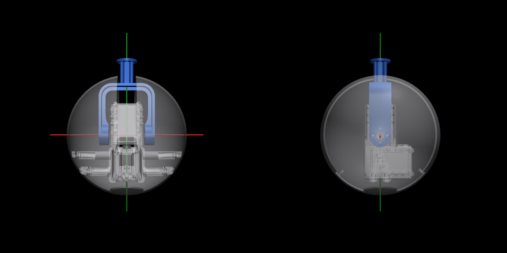

# Zero-gravity chain sim

A free-floating MuJoCo model of the MIT Universal Self-Folding Chain Robot (Mutis et al., ACM SCF 2025).
By default there is no gravity and no tether. You can drive it with sliders and the keyboard, or play folding
sequences, and log how its centre of mass and angular momentum behave. The chain floats horizontally about 1 m above
a floor; turn gravity on and it drops onto the floor.



## Setup (once)

Run all of the commands below from this `simulation/` folder. Setup needs [uv](https://docs.astral.sh/uv/).

```bash
cd simulation
```

```bash
uv venv --python 3.11 .venv
```

```bash
uv pip install --python .venv/bin/python -r requirements.txt
```

On a Mac the MuJoCo viewer needs `mjpython`, which ships in `.venv/bin/`. Everything that doesn't open a window runs
with plain `.venv/bin/python`.

## Control window (no shell needed)

Double-click **`Chain Sim.command`** in Finder. A Terminal window opens and must stay open, because it runs the app.
The first time, macOS may ask whether Terminal can access the Desktop folder; allow it. Then the **Chain Sim**
control window and the MuJoCo viewer open side by side.

| Section | What it does |
|---|---|
| The six demos | One button per class simulation: **1 Free float**, **2 Anchored**, **3 Thrusters**, **4 Suction walk**, **5 Pole climb**, **6 Skater**. One click opens it in the viewer and plays it; press **Play** for another take. The other versions of each (e.g. let go spinning, the four gravities, the U / Z / L shapes, the clamp crawl along a handrail) are in the Setup list. |
| Setup | Pick a whole run from `setups/` (see [Setups](#setups-setups)); the line under it says what the run shows. **Load** fills in every setting below and opens the viewer; then press **Play**. **Save as...** saves the current settings as a new setup, with a line saying what it shows. |
| Model | Pick the preset, number of modules and slip ring, and tick **Air drag** (cabin air on the shells) or **Net cage** (the cage from `../hardware/spec.toml`) for flight-like runs. |
| End effectors | An extra module on either end: none, **anchor** (a clamp), **suction** cup or **thruster** (five nozzles). The one past m1 sits on module 1's twist servo (`m1_yaw`). Picking a type shows its settings: an anchor or cup can **start** floating, on a surface (x, y, z and the way the surface faces) or on the rod (how far along), with a roll; a cup has its pull limit, diameter and friction; a thruster its push per nozzle. While running: **Hold** / **Let go** (an anchor or cup told to hold grabs whatever fixed thing it touches), or the nozzle tick boxes n0 (out of the end) to n4 (sideways). If ee1 starts attached, it sets where the chain starts, and the other end's placement greys out. **Rod to grab** (in Model) adds the setup's rod. Then click **Rebuild + open viewer**, which applies Model and End effectors and restarts the viewer. |
| Fold sequence | Pick a CSV from `../sequences/` (or **Browse...**), set move/hold seconds and speed, then **Play / Pause / Resume / Restart / Stop**. **Speed x** makes the moves themselves faster (so the physics changes); **Playback x** only shows the simulation faster than real time, e.g. ×2 to watch a 20 s clip in 10 s (the readout says if the computer can't keep up). **Play** a second time, or **Restart**, starts a fresh take from the start pose, so every take is the same. **Countdown s** (5 to start with): Play and Restart first show T-5 … T-1 big in the viewer, with the chain held still, so a recording starts clean; 0 starts at once, and Pause, Stop or Reset pose during it calls the take off. **Pause** and **Stop** also turn the nozzles off. |
| World | **Gravity** on/off and its strength, **Straighten** (all joints to 0), **Reset pose** (back to the start: the setup's start pose, or floating straight, at rest), and **Pause physics / Resume physics**, which freezes the whole simulation (time, motion, sequence, log) so you can look around. |
| Spin | Set a rate in deg/s, pick an axis (vertical, along the chain, across) and press **Spin**. The whole chain starts spinning about that axis through its centre of mass, keeping its shape and any spin about the other axes. **Stop spin** brings it to rest. A small rate (0.5–5 deg/s) stands in for the leftover spin when the chain is let go in flight. This is a push from outside: it gives the chain angular momentum, which then stays constant. Fold while spinning and it speeds up, like a skater pulling their arms in. Tick **Also spin like this when Play starts** to give the chain this spin as the sequence starts: the spin at release. |
| Record | **Log to logs/** writes `logs/run_<date>_<time>.csv` while ticked. **Screenshot** saves the viewer's view to `screenshots/`. **Open folder** opens this folder in Finder. |
| Readouts | Time, sequence progress and length (flagged if it's longer than one ~20 s parabola), gravity, **spin** (the whole chain's spin rate about the vertical: angular momentum ÷ inertia), **turned** (how far the middle module has turned about the vertical since the last reset; twists about the chain's own axis don't count), **IMU turn** (how far the IMU's module has turned in 3D since the last reset, as the flight IMU will see it), centre-of-mass drift, total angular momentum, max servo torque, contacts and log file, the playback rate, and a line per end effector (holding / ready to grab / let go, with the clamp's force and torque, a cup's pull of its limit and pops, or the thrust). These are also drawn in the top-left of the viewer, and when a sequence finishes the viewer's Terminal prints a one-line summary. |

The viewer's own sliders and keys still work alongside it. Closing the control window also closes the viewer.

## Commands

| What | Command |
|---|---|
| Summarise a .3dm file (units, layers, objects, boxes) | `.venv/bin/python inspect_3dm.py "../hardware/cad/Single module existing.3dm"` |
| Re-export the STLs from `../hardware/cad/complete chain.3dm` | `.venv/bin/python export_meshes.py` |
| Generate `chain.xml` (12 × original14) | `.venv/bin/python make_chain.py` |
| Viewer: sliders + keyboard | `.venv/bin/mjpython play.py` |
| Viewer: play the fold sequence | `.venv/bin/mjpython play.py --seq ../sequences/fold_sequence.csv` |
| No viewer: run the sequence and log | `.venv/bin/python play.py --seq ../sequences/fold_sequence.csv --headless` |
| Viewer with Earth gravity (drops to the floor) | `.venv/bin/mjpython play.py --gravity 9.81` |
| Flight-like: 4× faster, let go with 1 deg/s of spin, air, cage | `.venv/bin/python play.py --seq ../sequences/reorient_loop.csv --headless --speed 4 --spin 0 0 1 --air --cage` |
| Run a whole setup (end effectors, timing, spin...) and log | `.venv/bin/python play.py --setup setups/1a_turn.toml --headless` |
| Run all checks and renders | `.venv/bin/python verify.py` |
| Control window (same as double-clicking `Chain Sim.command`) | `.venv/bin/python panel.py` |

`play.py` options: `--model FILE.xml` (without it, the model is built fresh from `../hardware/spec.toml`), `--seq FILE`, `--move 3` (seconds between rows), `--hold 1` (seconds per row),
`--log logs/run_log.csv`, `--headless`, `--gravity 9.81` (m/s² towards the floor, overriding the model), `--speed 4`
(play the sequence 4× faster), `--spin X Y Z` (start spinning at these deg/s about world x, y, z), `--air`, `--cage`, and
`--setup FILE`, which sets the model and all of these from a setup file (flags you also give win). A headless run ends
with one line: how far it turned, the IMU turn, its spin and how far the centre of mass moved.

## Setups (`setups/`)

A setup file holds everything about a run that the sequence CSV doesn't: the sequence and its timing, gravity, the spin
at release, air and cage, the chain (preset, modules) and the end effectors. Its first line says what it shows. The
format is in `setup_file.py`; the files are plain text, so you can also edit them by hand.

The six class simulations, each about 20 s (zero g unless it says otherwise):

| Simulation | Setup | What it shows | Headless result |
|---|---|---|---|
| 1. Free float | `1a_turn` | Turns with no push: 4 fold loops that each end straight, at flight timing | turned −30.3° in 20.25 s |
| | `1b_spin_0.5` | The same, let go spinning at 0.5°/s | −15.2°: half the turn gone |
| | `1b_spin_1` | The same, let go spinning at 1°/s | 0.0°: cancelled |
| | `1c_roll` | Rolls about its own length (pitch fold plus twist, twice), 2× speed | IMU turn 63.4° in 16.5 s |
| 2. One end anchored | `2a_arm` | A wall-mounted arm: curls, turns on ee1's twist servo, reaches | peak clamp load 4.0 N |
| | `2b_stall_1g`, `_mars`, `_moon`, `_0g` | Hanging from a wall, told to stand straight out, at four gravities | lifts 13° / 24° / 44° / all the way |
| | `2c_let_go` | Swings fast and lets go mid-swing | drifts off at 150 mm/s, spinning |
| 3. Thrusters | `3a_straight`, `_U`, `_Z`, `_L` | Folds, fires both end nozzles briefly, coasts | nothing; glides 0.93 m; spins 8.2°/s; both |
| 4. Suction cups | `4a_walk` | Inchworm walk, one foot always holding (80 mm, 60 N cups) | 1.10 m in 19 s |
| | `4b_both_off` | The same, letting go too early | floats off the floor |
| 5. Pole climb | `5_pole_climb` | Wrapped around a Ø100 mm pole like a snake, it climbs by squeezing: no cups, no clamps | 394 mm up in 19.3 s |
| | `5a_rod_crawl` | Clamps on both ends crawl along a thin handrail | 1.115 m along the rod in 19 s |
| 6. Skater | `6_skater` | Spinning at 20°/s, folds into an L and a zig-zag | speeds up folded, back to 20.0°/s straight |

`stall_sweep.py` turns the 2b setups into experiment A's number, the longest chain that stands out level at each
gravity (about a minute). Results and what they mean are in `../experiments/findings.md`, "The class simulations".

### Keyboard (viewer)

| Key | Action |
|---|---|
| PageUp / PageDown | select next / previous module (the selected one turns orange) |
| Up / Down | pitch of the selected module ±5° |
| Right / Left | yaw of the selected module ±5° |
| Space | pause / resume the physics (the viewer's own Pause button is greyed out) |

You can also drag the sliders in the viewer's **Control** panel on the right. While a sequence is playing, the sequence
overrides both the keys and the sliders. If a key clashes with a viewer shortcut, change `KEYS` at the top of `play.py`.

## Gravity and the floor

- **Default: zero gravity.** The chain floats high enough that no fold can reach the floor: more than half its
  length plus a shell diameter. The floor is just a visual reference.
- **To drop it,** use `play.py --gravity 9.81`, or `make_chain.py --gravity 9.81` to build gravity into the XML. You can
  also edit **Physics → gravity** in the viewer's left panel. That field is an x y z vector: Earth is `0 0 -9.81`.
  Something like `1 1 1` pulls diagonally upwards, which is why it drifted sideways.
- **Lying on the floor,** the chain runs along world +Y with its pitch axes vertical, so pitch folds lie flat on the
  floor. Change `CHAIN_ROLL` in `make_chain.py` (90°) to make pitch lift modules off the floor instead.
- **Rolling resistance.** Each module's centre of mass is about 7 mm off its shell centre, so a dropped module behaves
  like a lopsided ball. The floor therefore has rolling resistance (`ROLLING_RESISTANCE = 0.03`) so the chain settles
  within about 10 s. This value is tuned for settling, not measured. Below about 0.01 it keeps rocking.

## Switching presets

```bash
.venv/bin/python make_chain.py --preset dyna7 -o chain_dyna7.xml
```

```bash
.venv/bin/mjpython play.py --model chain_dyna7.xml --seq ../sequences/fold_sequence.csv
```

| Preset | Servo | Stall torque | Pitch | Mesh scale | Timestep |
|---|---|---|---|---|---|
| `original14` | Dynamixel AX-12A | 1.5 N·m | 14 cm | 1.0 | 0.5 ms |
| `dyna7` | Dynamixel XL330-M288 | 0.52 N·m | 7 cm | 0.5 | 0.1 ms |
| `feetech7` | Feetech STS3032 | 0.44 N·m (peak) | 7 cm | 0.5 | 0.1 ms |

Other flags: `-n 8` sets the number of modules (minimum 2), and `--slip-ring` removes the yaw limits. Yaw targets then span ±360°, which
keeps the sliders usable. Pitch stays at ±124° because the shell, not the cable, limits it. The real chain's numbers (masses, sizes, ranges,
servo) are in `../hardware/spec.toml`. The what-if presets and the sim's own tuning are in `PRESETS` and the constants at
the top of `make_chain.py`. Run `verify.py` again after changing either.

## Files

| File | What it does |
|---|---|
| `../hardware/cad/*.3dm` | The CAD inputs (mm): `Single module existing.3dm`, `complete chain.3dm`. These are never modified. |
| `inspect_3dm.py` | Prints units, layers, objects, colours, types and tight mesh bounding boxes. |
| `export_meshes.py` | Writes `meshes/*.stl`, one per rigid body, in the module frame, in metres, under 20k triangles. |
| `meshes/` | `base_first.stl` (module 1), `base_mid.stl` (2–11), `base_last.stl` (12), `arm.stl` (1–11). |
| `../hardware/spec.toml` | The real chain's numbers, shared with the robot software. `make_chain.py` reads them. |
| `make_chain.py` | Parametric generator for `chain.xml`. |
| `chain.xml` | Generated model, written by `make_chain.py`. Not in git. |
| `meshes/SOURCE.txt` | Which CAD file the meshes were exported from; `verify.py` fails if the CAD has changed since. |
| `Chain Sim.command` | Double-click launcher for the control window. |
| `panel.py` | Control window: buttons that build the model and drive the viewer. |
| `setup_file.py`, `setups/` | Reads and writes setup files; `setups/` holds the example runs. |
| `panel_setup.toml` | What the control window last opened the viewer with (it starts `play.py --setup` with it). Not in git. |
| `stall_sweep.py` | The stall length at Earth, Mars, Moon and zero g, from the 2b setups. |
| `pole_climb_design.py` | Designs the pole climb (pole size, squeeze, stretch) and writes its sequence and setup. |
| `play.py` | Viewer, keyboard, sequence playback, logging, live readouts; takes commands from `panel.py`. |
| `../sequences/` | Fold-sequence CSVs, shared with the robot software; the control window lists these. `fold_sequence.csv` goes straight → L → straight → zig-zag → straight. `reorient_loop.csv` turns the whole chain ~30° with no push (4 shape loops that each end straight). Add your own here. |
| `logs/` | Run logs: `run_log.csv` from the shell, `run_<date>_<time>.csv` from the control window. |
| `screenshots/` | Written by the control window's **Screenshot** button. |
| `verify.py` | Checks plus PNG renders in `renders/`. |
| `renders/` | Written by `verify.py`, not in git: `module.png`, `module_pitch60.png`, `chain12.png`, `fold_L.png`, `fold_zigzag.png`, `gravity_drop.png`. |
| `AGENTS.md`, `LOG.md` | Decisions behind the model (for coding agents), and the history of changes. Measurements are in `../hardware/AGENTS.md`. |

## The model in brief

- **Two rigid bodies per module.** The **base** is the shell, bracket and both servos; it's one body because the
  connector pins lock the core to both shell halves. The **arm** is the U-yoke and hub.
- **Pitch** is about +X through the module centre: the pitch servo's horn turns the yoke. **Yaw** is about +Z: module
  *i*'s hub bolts onto module *i+1*'s downward-facing yaw horn. These axes are in each module's own frame. With all
  joints at zero the chain is straight, 140 mm centre to centre, and in the world it lies along +Y.
- **In zero g a joint turns both sides, split by how hard each side is to turn.** That's moment of inertia, mass ×
  distance², not mass alone. The relative angle is always what you commanded, and the centre of mass doesn't move.
  Measured with one joint commanded to 60°:

  | Joint | Side before the joint | Side after |
  |---|---|---|
  | m6_pitch, all modules equal | −33.7° | +26.3° (modules 7–12 extend one pitch further) |
  | m6_pitch, modules 1–6 twice as heavy | −30.6° | +29.4° |
  | m6_pitch, modules 7–12 twice as heavy | −36.4° | +23.5° |
  | m3_pitch (3 modules vs 9) | −54.1° | +5.9° |
  | m1_pitch (1 module vs 11) | −60.0° | 0.0° |

  So end joints move the end module, not the chain. m1_pitch spins module 1's whole base (shell, servo, U2D2), and
  that's real behaviour, not a disconnected part.
- **22 actuated joints, not 24.** Module 1 has no yaw servo; it carries the U2D2 and power hub instead. Module 12 has
  no pitch servo or arm. Both of these come from `complete chain.3dm`.
- **End effectors** (optional): one module-sized sphere (Ø139 mm) one pitch past m1 and/or past m12. The one past m1
  turns on `m1_yaw` (±150°, the same sign as every yaw); the one past m12 is rigid. Masses are placeholders in
  `make_chain.py`: anchor and suction cup 200 g, thruster 250 g, plus 55 g for the twist servo.
  - **Anchor:** a clamp that never slips (a weld to a fixed body moved to where the end is). Told to hold, it grabs
    when its Ø40 mm tip face comes within 15 mm of something fixed, pulling the face onto it over 0.2 s.
  - **Suction cup:** a cup on the tip that only ever touches fixed things, sucking with its pull limit. It holds by
    friction sideways, pops above the limit and peels if it tips: it has to be pressed on to stick.
  - **Thruster:** five nozzles, n0 out of the end and n1–n4 sideways; each pushes against its exhaust and lights up.
- **Visuals vs physics.** Meshes are visual only. Each module collides as one sphere (Ø139 mm). Mass sits on simple
  primitives: a hollow sphere for the shells, plus a box for the core and a box for the arm.
- **Servos** are position actuators. Their force limit is the stall torque plus the gear friction, so the net output at
  stall is the rated stall torque. Stall torque is reached at 10° of position error. Damping is stall torque divided by no-load speed, so a saturated servo moves at its rated speed.
  A 5 ms lag smooths each target.
- **No springy wobble.** Each joint also has gearbox friction (7% of stall torque), the motor's inertia through the
  gearbox (`armature`), and velocity braking whenever the servo isn't saturated (`kv`). The AX-12A has no such
  braking of its own; `kv` stands in for damping the model doesn't otherwise capture, until a joint is measured on
  the bench.
  - A 60° jump at m6 now overshoots about 1° and settles in 0.5 s. Before, it overshot 9.5° and swung 15 times.
  - These values are estimates. Raise `kv` in `PRESETS` for stiffer, slower stops, or lower it for snappier ones.
- **Integrator.** It uses RK4, because the default integrator let the centre of mass wander tens of millimetres during
  random motion. RK4 is only stable below a timestep limit, so lighter modules need a smaller timestep (see Physics choices below).

### Fold sequence CSVs (`../sequences/`)

The full format, shared with the robot software, is in `../sequences/README.md`. In brief:

Each row is one keyframe of 24 angles in degrees, in the order `m1_yaw, m1_pitch, …, m12_yaw, m12_pitch`. A header
row naming the columns is optional, and lines starting with `#` are skipped. `m12_pitch` has no servo, and neither has
`m1_yaw` unless an end effector is fitted past m1 (it's that end effector's twist servo); a column without a servo is
ignored, with a warning if it's not zero. Rows are eased between with a cosine profile over `--move`
seconds, and each row is held for `--hold` seconds. Targets update every 10 ms, like commands on a servo bus.

### Log files (`logs/`)

Columns: `time`, `com_x/y/z` (chain centre of mass, m), `L_x/y/z` and `L_norm` (total angular momentum about the
centre of mass, kg·m²/s), `max_torque` (largest |actuator torque|, N·m), `contacts` (number of contacts), then what the
flight IMU will report: `imu_qw/qx/qy/qz` (its module's attitude, world frame) and `imu_wx/wy/wz` (its rotation rate,
rad/s, in its own frame). The IMU's module is set in `../hardware/spec.toml`. With end effectors fitted, four
columns per end follow: `ee{k}_held` (0/1), `ee{k}_load_N` (clamp force or cup pull, smoothed over 0.1 s),
`ee{k}_torque_Nm` (clamp torque) and `ee{k}_thrust_N`. One row is written every 10 ms.

## How the meshes are made
- **Grouping:** by layer (`Link::*` → arm, everything else → base). The module comes from the height of each object's
  centre (rounded for the base; floored with a +20 mm bias for the arm).
- **Decimation is vertex clustering, not quadric.** Quadric decimation failed on the open, 165-piece servo meshes and
  moved parts by up to 9.6 mm. Shells keep full resolution; the grid is chosen by bisection (about 1.6–2.0 mm).

## Verified (`verify.py`)

- All three presets compile, with and without `--slip-ring`.
- Every joint's axis and anchor is correct.
- A 30° test turn moves everything downstream rigidly about the right axis.
- The yoke discs are centred on the pitch axis (within 0.002 mm) and the hub on the yaw axis (within 0.014 mm).
- 12 s of smooth random motion: the centre of mass moves ≤ 0.005 mm, and |L| stays below 10⁻⁷ of the summed body
  momenta.
- No contacts with the chain straight (neighbouring spheres are 1 mm apart), and none during the fold sequence.
- With gravity at 9.81 m/s², every preset drops onto the floor and settles within 15 s, with all 12 shells resting
  on it.
- Spin about one axis leaves the spin about the others alone.
- The IMU output reads 10.00 deg/s and 20.00° after 2 s of a 10 deg/s spin.
- Weighed module masses add up.
- Air drag slows a 20 deg/s spin to 18.6 deg/s in 10 s.
- With 0.01 g left over, the chain reaches the net cage after about 3 s.
- End effectors: every type at either end compiles and leaves the 12 modules exactly as they were; `m1_yaw` twists
  about the chain axis; with both ends fitted the centre of mass still moves ≤ 0.006 mm in 12 s of random motion.
- Setup files refuse misspelt keys and missing sequences, and Save as then Load gives the same setup back.
- **What it doesn't check:** anything against the real chain. These are consistency checks, not validation.

## Physics choices
Why the model is built the way it is. Kept here so `AGENTS.md` stays short; read before changing any of these.
- **Meshes and collision:** meshes are visual only (`mass=0`, no contacts). Each base collides as one sphere;
  neighbouring bases are excluded from colliding.
- **Mass:** the sphere carries `shell_frac × base_mass` with `shellinertia`. The rest of the base's mass sits on a core
  box, and the arm has its own box. Sizes are in `make_chain.py`.
- **Servo model:**
  - `kp = stall / 10°`. This roughly matches the AX-12A's default compliance slope (32 steps ≈ 9.4°).
  - `forcerange = ±stall × (1 + GEAR_FRICTION)`. The motor also has to overcome the gear friction, so the net torque at
    the output at stall is the rated stall torque. Before 2026-10-22 it was ±stall, so the output was 7% low.
  - Damping = stall torque / no-load speed, so the no-load speed emerges when the servo saturates.
  - `timeconst` = 5 ms lag on targets.
  - **Anti-wobble (2026-10-20):**
    - Three additions: `frictionloss` = `GEAR_FRICTION` (7%) × stall torque, a per-preset `armature` (0.002 / 0.0002
      kg·m²), and actuator `kv` (1.0 / 0.25).
    - `kv` acts whenever the servo isn't saturated, which in smooth moves is nearly all the time. It's a stand-in for
      damping the model doesn't otherwise capture, not something the AX-12A does; see open issue 9.
    - Effect on a 60° step at m6: before, 9.5° overshoot, 15 swings, 3.5 s to settle, 8° flex. After, 1°, 2 swings,
      0.5 s, 2.7°.
    - **`armature` is what makes `kv` possible** at a 0.5 ms timestep; without it the light twist mode goes unstable.
    - All three are internal, so momentum is conserved and the zero-g split is unchanged.
- **End effectors:** each collides as one sphere and carries its mass as a solid sphere (placeholder masses are
  `EE_MASS` and `EE_SERVO_MASS` in `make_chain.py`, × s³ for the 7 cm presets; not in the spec until one is designed).
  With any fitted, the float height and `statistic extent` count them as modules.
- **7 cm presets:** lengths × 0.5. Printed mass × 0.5³ plus real servo masses (XL330 18 g, STS3032 about 20 g).
- **Integrator: RK4.**
  - implicitfast drifted the centre of mass 135 mm in 12 s of random motion; RK4 drifts 0.005 mm.
  - Stability needs timestep < ~2.8·(I_twist + armature)/(4·(damping + kv)): 0.5 ms for original14 and 0.1 ms for the
    7 cm presets.
  - Without the 5 ms lag, 10 ms target steps make conservation about 100× worse.
- **Floor contact:** `condim 6` with rolling friction = `ROLLING_RESISTANCE` × R. Without it, the bases' ~7 mm
  centre-of-mass offset makes a dropped chain rock forever, because energy is conserved.
- **World layout:**
  - The chain floats along world +Y at height n·pitch/2 + 2R, so a zero-g fold can't reach the floor at z = 0.
  - `CHAIN_ROLL = 0` makes the pitch axes vertical, so pitch folds lie flat on the floor.
  - Gravity defaults to 0.
- **Ranges:** pitch ±124°, yaw ±150°. `--slip-ring` frees yaw only, with targets spanning ±360°.
- **Flight options** (`--air`, `--cage`, panel tick boxes; numbers in `[flight]` in the spec):
  - **Air drag** is MuJoCo's ellipsoid fluid model on the shells only; the boxes inside get zero coefficients. For a
    spinning chain it gives about twice the loss of a hand estimate, so treat it as an upper bound.
  - **The net cage** is six thin static boxes around the start pose, with a soft `solref` (0.05 s) standing in for a
    net. Its size is a placeholder.
  - **Leftover gravity in the cabin** is just the gravity setting. A uniform pull doesn't change the turn (checked to
    0.01°); it only moves the chain into the cage.

## Interface details
- `physics` freezes the whole sim through `Session.running`; `pause` only holds the fold sequence.
- **`spin`** adds a rigid rotation about the centre of mass to the free joint.
  - Root linear velocity += Δω × (p_root − c), and root angular velocity += Δω, with Δω along one world axis.
  - That sets that axis's component of I⁻¹L to the rate, while leaving the other components, the shape and the joint
    velocities alone. `axis="all"` (Stop spin) sets all three.
  - It's an outside push, so it changes L. It also stands in for the leftover spin at release (`--spin X Y Z`).
  - Before 2026-10-22 it reset the x and y components too.
- **Readouts:**
  - `spin` = (I_total⁻¹ L)_z, the whole chain's rate if its shape froze.
  - `turned` = the heading change of m6's chain axis about the vertical since the last reset. The module-1-to-12 line
    was rejected because a tip swing alone moves it about 5°.
  - `IMU turn` = the 3D angle the IMU's module has turned since the last reset: what the flight IMU will report.
  - The `sequence` line shows the sequence's length at the current speed, and flags it if it's longer than one
    parabola (`parabola_s` in the spec).
- **Timing:** `Session` keeps a sequence clock separate from sim time (for speed, pause and restart). Targets update
  and the log writes every 10 ms (`mj_step(nstep=…)`).
- **Screenshots** use an offscreen `mujoco.Renderer` with the viewer's camera.
- **Viewer keys:** PageUp/PageDown select a module, Up/Down nudge pitch, Right/Left nudge yaw, Space pauses physics.
- **Viewer window (macOS):** it reopens at the size and place it last had. macOS keeps that as `NSWindow Frame
  CATENA viewer` in `defaults read org.mujoco.mjpython`; `defaults delete` that key to forget it.
  - Its UI size (Option → Font) is chosen when it opens, and MuJoCo's Python API can't change it, so it doesn't change
    when you drag the window to another display.
  - On a 1x monitor next to the Retina it opens at 150%, because MuJoCo judges the density from the Retina. Pick 100%
    there, or reopen the viewer on the display you'll use.
- **Countdown:** the viewer holds the commands after `countdown {s}` (the take's spin and play) and the physics until
  it ends, drawing T-n big at the top, so sim time doesn't move and the take starts exactly at T-0.
- **Tested in the real GUI:** Play (2026-10-17), layout screenshots, and Spin → Play → Stop spin (2026-10-21).
